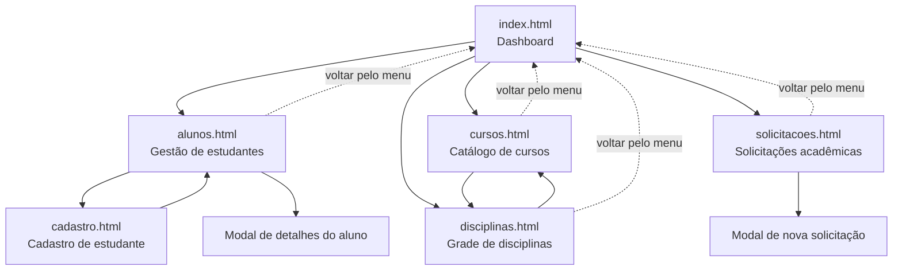

# Portal Acadêmico

Sistema de Gestão Acadêmica desenvolvido como um projeto **Front-End estático** para demonstração de uma interface administrativa acadêmica.

O projeto utiliza somente:

- HTML5 semântico;
- CSS3;
- Bootstrap 5.3.3 via CDN oficial;
- JavaScript puro para comportamentos visuais simples.

Não existe banco de dados, API ou back-end. Os registros apresentados nas telas são fictícios e estão inseridos diretamente no HTML.

---

## 1. Objetivo do projeto

O Portal Acadêmico organiza, em uma única interface, informações comuns de uma instituição de ensino:

- indicadores gerais da instituição;
- consulta de estudantes;
- catálogo de cursos;
- cadastro visual de estudantes;
- grade de disciplinas;
- acompanhamento de solicitações acadêmicas.

O foco do projeto é demonstrar organização de telas, navegação, responsividade, uso correto do Grid do Bootstrap e criação de componentes reutilizáveis com HTML e CSS.

---

## 2. Estrutura de diretórios

```text
portal-academico/
├── index.html
├── alunos.html
├── cursos.html
├── cadastro.html
├── disciplinas.html
├── solicitacoes.html
├── README.md
├── css/
│   └── style.css
├── js/
│   └── script.js
└── img/
    └── logo.png
```

### Responsabilidade dos arquivos

| Arquivo | Responsabilidade |
|---|---|
| `index.html` | Dashboard com indicadores, atividade recente e distribuição por modalidade. |
| `alunos.html` | Lista de estudantes, busca textual, status e modal de detalhes. |
| `cursos.html` | Catálogo visual dos cursos disponíveis. |
| `cadastro.html` | Formulário de cadastro visual de estudantes. |
| `disciplinas.html` | Grade curricular com busca por disciplina, código ou professor. |
| `solicitacoes.html` | Fila de solicitações acadêmicas e modal para nova solicitação. |
| `css/style.css` | Cores, tipografia, cartões, badges, tabelas e ajustes responsivos. |
| `js/script.js` | Ano automático, filtros de tabela e validação visual do formulário. |
| `img/logo.png` | Placeholder físico do logotipo. Algumas páginas também utilizam um SVG inline. |

---

## 3. Fluxo de navegação das páginas

O fluxo principal começa no Dashboard. A Navbar está presente nas páginas principais e permite acessar os módulos diretamente.



### Fluxo detalhado

#### 1. Dashboard

Arquivo: [`index.html`](./index.html)

É a página inicial do sistema. Exibe:

- quantidade de alunos ativos;
- quantidade de cursos;
- solicitações pendentes;
- frequência média;
- solicitações recentes;
- distribuição de alunos por modalidade.

O botão **“Ver tudo”** direciona o usuário para `solicitacoes.html`.

#### 2. Gestão de estudantes

Arquivo: [`alunos.html`](./alunos.html)

Apresenta uma tabela com:

- nome e avatar;
- matrícula;
- curso;
- período;
- situação acadêmica;
- botão de detalhes.

O botão **“Novo aluno”** leva para [`cadastro.html`](./cadastro.html).

Os botões **“Detalhes”** abrem o modal `#modalAluno`. A conexão ocorre por meio de:

```html
data-bs-toggle="modal"
data-bs-target="#modalAluno"
```

O valor de `data-bs-target` deve corresponder exatamente ao `id` do modal.

#### 3. Cadastro de estudante

Arquivo: [`cadastro.html`](./cadastro.html)

Permite preencher, apenas para demonstração:

- nome;
- e-mail;
- CPF;
- data de nascimento;
- curso;
- observações.

O formulário não envia dados para servidor. O JavaScript verifica os campos obrigatórios e exibe uma mensagem de sucesso localmente.

O botão **“Cancelar”** retorna para `alunos.html`.

#### 4. Catálogo de cursos

Arquivo: [`cursos.html`](./cursos.html)

Exibe cards de cursos com:

- ícone;
- nome;
- descrição;
- duração;
- situação;
- botão para consultar disciplinas.

O botão **“Ver disciplinas”** direciona para `disciplinas.html`.

#### 5. Grade de disciplinas

Arquivo: [`disciplinas.html`](./disciplinas.html)

Apresenta uma tabela com:

- código;
- disciplina;
- curso;
- professor;
- horário;
- quantidade de vagas.

O campo de busca usa o atributo `data-table-filter` para informar ao JavaScript qual tabela deve ser filtrada.

Exemplo:

```html
<input data-table-filter="#tabelaDisciplinas">
```

O script lê esse seletor, compara o texto digitado com cada linha e oculta as linhas que não correspondem.

#### 6. Solicitações acadêmicas

Arquivo: [`solicitacoes.html`](./solicitacoes.html)

Exibe uma fila com:

- protocolo;
- tipo da solicitação;
- estudante;
- data;
- status;
- ação disponível.

O botão **“Nova solicitação”** abre o modal `#modalSolicitacao`, no qual o usuário pode selecionar o tipo e preencher detalhes fictícios.

---

## 4. Responsividade

O projeto utiliza o sistema de Grid do Bootstrap:

```html
<div class="row g-4">
  <div class="col-md-6 col-xl-4">...</div>
</div>
```

- `row` cria uma linha flexível;
- `g-4` adiciona espaçamento entre as colunas;
- `col-md-6` ocupa metade da largura a partir de telas médias;
- `col-xl-4` ocupa um terço da largura em telas grandes;
- abaixo do breakpoint `md`, as colunas passam a ocupar toda a largura.

As tabelas utilizam:

```html
<div class="table-responsive">
  <table class="table">...</table>
</div>
```

A classe `table-responsive` fica na `<div>` externa porque o Bootstrap aplica nela o comportamento de rolagem horizontal. Assim, a tabela mantém sua estrutura e pode ser consultada em telas pequenas sem quebrar o layout.

---

## 5. Componentes Bootstrap utilizados

### Navbar responsiva

As classes `navbar`, `navbar-expand-lg`, `navbar-dark` e `navbar-toggler` criam uma barra de navegação que se adapta ao tamanho da tela.

O botão mobile utiliza:

```html
data-bs-toggle="collapse"
data-bs-target="#menu"
```

Esse atributo abre ou fecha o elemento que possui `id="menu"`.

### Cards

Os cartões combinam classes Bootstrap, como `p-4`, `h-100`, `shadow` e `rounded`, com classes próprias do arquivo `style.css`.

### Badges

Os badges identificam rapidamente estados como:

- ativo;
- concluído;
- em análise;
- recebida;
- lotada.

### Modal

Os modais são componentes interativos do Bootstrap. O JavaScript oficial do Bootstrap é carregado pelo arquivo `bootstrap.bundle.min.js`, que inclui o Popper necessário para componentes como dropdowns e modais.

### Formulário

O formulário usa `form-control`, `form-select`, `invalid-feedback` e `was-validated` para apresentar uma validação visual consistente.

---

## 6. JavaScript implementado

O arquivo [`js/script.js`](./js/script.js) possui somente comportamentos de interface:

1. Preenche automaticamente elementos com `data-current-year`.
2. Filtra linhas de tabelas a partir de campos com `data-table-filter`.
3. Intercepta o envio do formulário de cadastro.
4. Aplica validação visual com a classe `was-validated`.
5. Exibe uma mensagem local de sucesso quando os campos obrigatórios estão preenchidos.

Nenhum dado é persistido.

---

## 7. Como executar

Como o projeto é estático, basta abrir o arquivo [`index.html`](./index.html) em um navegador.

Para uma experiência mais próxima de um ambiente real, recomenda-se utilizar um servidor local, por exemplo com a extensão **Live Server** do VS Code:

1. Abra a pasta `portal-academico` no VS Code.
2. Clique com o botão direito em `index.html`.
3. Selecione **Open with Live Server**.
4. Navegue pelos módulos usando a Navbar.

Também é possível usar qualquer servidor HTTP estático compatível.

---

## 8. Limitações conhecidas

Este projeto é propositalmente um protótipo Front-End:

- os dados são fictícios;
- não existe autenticação;
- não há banco de dados;
- não há integração com API;
- filtros e validações funcionam somente no navegador;
- cadastro e solicitação não são persistidos;
- os botões de ação não executam operações reais de CRUD.

Para transformar o protótipo em uma aplicação completa, seria necessário adicionar uma API, banco de dados, autenticação, autorização por perfil e persistência das operações.

---

## 9. Identidade visual

As cores principais estão centralizadas em variáveis CSS:

```css
:root {
  --primary: #12355b;
  --primary-light: #1d5d8f;
  --accent: #f4b942;
}
```

Essa organização facilita futuras alterações de tema sem precisar modificar cada componente individualmente.
